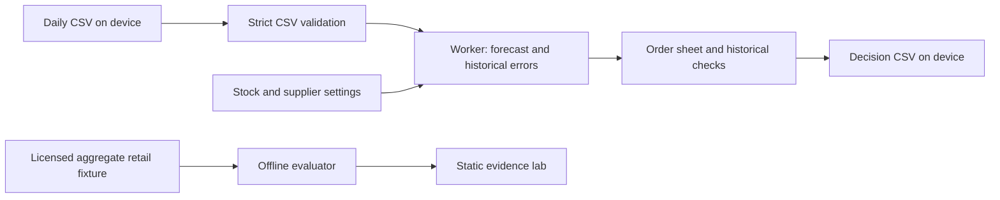

# Architecture

The public app is static HTML/CSS/ES modules. Its only runtime dependencies are browser APIs. Node 24 is used for development, evaluation, tests, and asset copying; no server code is deployed.

`web/engine.js` is the single calculation implementation imported by both the browser Worker and the offline evaluator. `web/app.js` owns routing, transient state, rendering, and file operations. It dispatches numbered jobs, discards stale replies, disables export while settings change, and terminates a Worker that exceeds 15 seconds. All imported sales are memory-only and disappear on reload; there is no analytics, storage account, database, or external inference call.

`scripts/prepare_benchmark.py` reconstructs an anonymous aggregate fixture from the licensed UCI archive. It emits no customer identifiers. Its raw download stays git-ignored. `scripts/evaluate.mjs` uses the same engine and fixed cohort to emit every held-out prediction plus summary JSON. CI checks that regeneration does not change the committed artifacts.

## Decisions

| Choice | Next best option | Reason and cost |
| --- | --- | --- |
| Browser-local ES modules | Python API plus React client | Avoid a second service, data uploads, sleeps and runtime charges. Costs browser-only operation and no automatic store sync. |
| Historical sum-error buffer | Normal independent daily errors | Match the actual protection period and allow skewed errors. Costs sensitivity to rare bulk purchases and dependent calibration windows. |
| Small explicit state machine | Framework and component library | Three views and a bounded workflow do not require runtime dependencies. Costs manual DOM rendering and careful accessibility tests. |
| Worker | Main-thread calculations | Keep inputs responsive and isolate timeouts. Requires a modern browser and module Worker support. |
| No automatic purchases | Store integration and purchase orders | Dataset cannot justify unattended decisions. Operator reviews stock availability, exact arrival dates and cash constraints. |
| GitHub Pages | Separate free compute service | Existing public repository, static bytes, no signup or card. Public/noncommercial hosting only; no SLA, backend or secret storage. |

## Operational limits

2 MB files; 120–3650 complete daily rows; sales <=1,000,000/day; integer stock <=1,000,000; pack <=10,000; fixed protection period <=42 days; >=20 calibration windows. An incomplete history or invalid number prevents a recommendation. Loaded data works when the network disconnects, but offline reload is not supported.

Render plain text for filenames and errors. Escape descriptions in the evidence lab. Imports accept only date and numeric sales into the engine; extra columns are discarded. The output contains only fixed field names and validated values, avoiding spreadsheet formula injection from imported metadata.

## Delivery

`.github/workflows/workbench.yml`: core tests, byte-for-byte evaluation regeneration, static build, headless main-flow/state/responsive tests, WCAG AA scan, mobile Lighthouse >=90, then Pages deployment from `main` and a live main-flow smoke test. The separate research CI installs the frozen Python environment and runs the retained 11 tests. Release text is checked before pushes and PRs; the local commit hook rejects forbidden provenance text.
